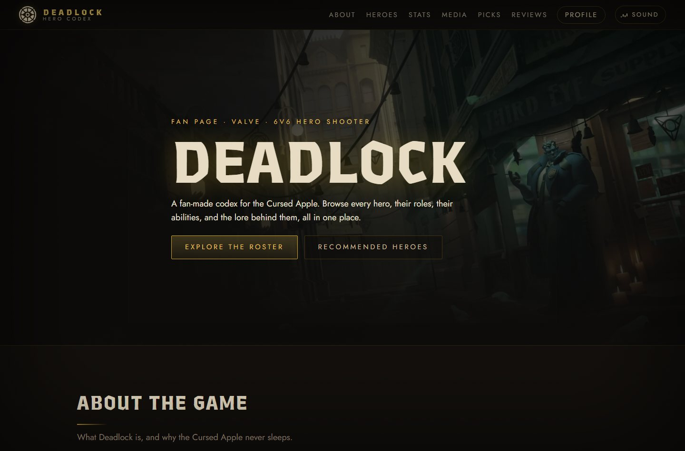
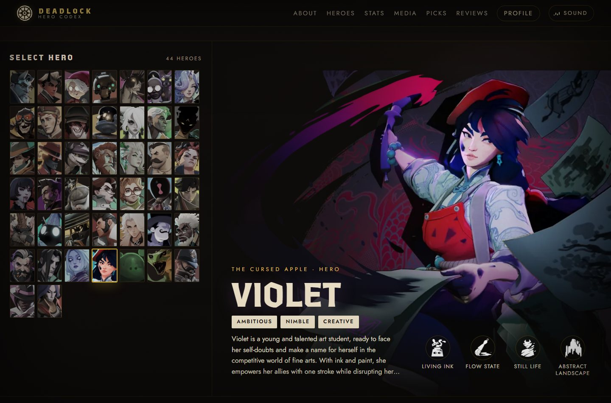
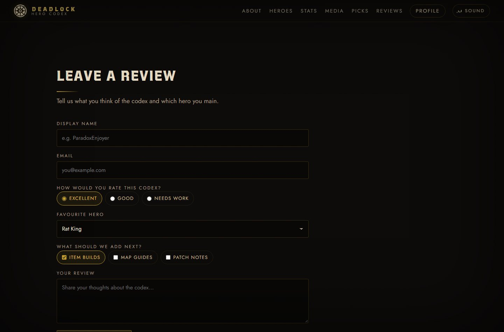
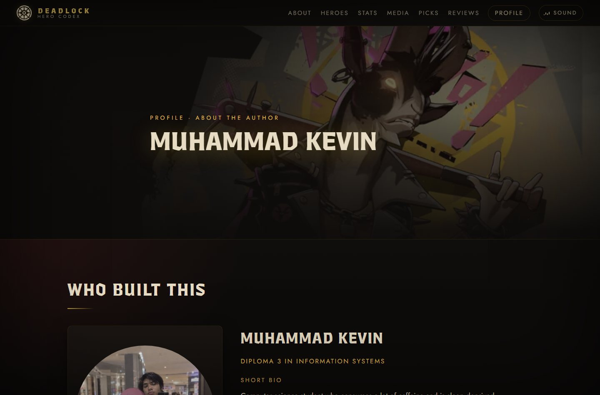

# Deadlock Hero Codex

Project ini dibuat sebagai Mini Project KSM Veterantech Frontend Basic dengan HTML dan CSS, lalu dikembangkan menjadi Final Project dengan tambahan tampilan responsif, fitur interaktif JavaScript, dan animasi. Topiknya adalah **Deadlock**, game MOBA third-person dari Valve. Website berisi katalog 44 hero lengkap dengan role, lore, ability, statistik, media, rekomendasi hero, dan form ulasan pengunjung.

| | |
|---|---|
| Nama | Muhammad Kevin |
| Kelas | Frontend Basic, KSM Veterantech UPNVJ 2026 |
| Topik | Fan page game Deadlock |
| Halaman | `index.html` (fan page) dan `profile.html` (profil pembuat) |
| Teknologi | HTML, CSS eksternal, JavaScript eksternal, Motion 14.14.0 (lokal) |
| Repository | https://github.com/RyuVyyn/MP_Muhammad_Kevin |

## Cara Menjalankan

Buka `index.html` langsung di browser, atau jalankan server statis dari folder project.

```bash
python -m http.server 8000
```

Lalu buka `http://localhost:8000`. Semua aset, font, dan library animasi disimpan lokal, jadi website tetap tampil benar tanpa koneksi internet.

## Struktur Folder

```text
MP_Muhammad_Kevin/
|-- index.html            halaman utama fan page
|-- profile.html          halaman profil pembuat
|-- README.md             dokumen ini
|-- link-github.txt       tautan repository
|-- css/
|   |-- reset.css         normalisasi dasar
|   +-- style.css         seluruh tampilan dan media query
|-- js/
|   |-- data.js           data 44 hero
|   |-- main.js           seluruh interaksi dan animasi
|   +-- vendor/
|       +-- motion.js     library animasi, dimuat lokal
|-- assets/               logo, avatar, font, dan 176 ikon ability
|-- character/            88 gambar hero, potret dan render
|-- video/                video showcase dan poster
|-- music/                musik latar
+-- screenshot/           25 tangkapan layar desktop dan mobile
```

## Dasar Mini Project (Pertemuan 1–4)

Struktur dan materi HTML serta CSS dari tahap Mini Project tetap dipakai pada versi Final Project ini. Bagian berikut mencatat di mana materinya berada, karena presentasi menuntut penjelasan perubahan dari Mini Project sebelumnya.

| Materi | Penerapan |
|---|---|
| Semantic HTML | `<main>` di `index.html` baris 58, `<aside>` baris 103, `<article>` baris 296, 308, dan 320, `<figure>` dengan `<figcaption>` baris 269 sampai 284, plus `header`, `nav`, `section`, dan `footer` |
| Teks dan heading | `<h1>` baris 64, `<h2>` pada setiap section, `<strong>` baris 86, `<em>` baris 87, paragraf About baris 86 sampai 100 |
| List | `index.html` baris 105, 126, 186, 198, 392, 409, dan 419 |
| Tabel | `index.html` baris 234 sampai 261, lengkap dengan `<caption>`, `<thead>`, `<tbody>`, dan `<tfoot>` |
| Media | gambar di seluruh halaman, `<video>` baris 275, dan `<audio>` baris 432 |
| Link intra-page | `#top` baris 17, `#about` baris 26, `#roster` baris 27 dan 71, `#stats` baris 28, `#media` baris 29, `#picks` baris 30 dan 72, `#review` baris 31 dan 412 |
| External link | `index.html` baris 420 sampai 422, `profile.html` baris 108, 113, 148, dan 149 |
| Form | `index.html` baris 340 sampai 395, berisi `input`, `select` baris 362, dan `textarea` baris 382 |
| Box Model | deklarasi `padding`, `margin`, dan `border` tersebar di `css/style.css` |
| Position | `sticky` baris 126, `relative` baris 187, 405, 658, dan 967, `absolute` baris 199, 381, 396, 708, 1028, dan 1456 |
| Pseudo-class | `:hover` pada 17 aturan, `.hero-tile`, `.card`, dan `.ability-icon` di antaranya, `:focus-visible` pada 10 selector, `:nth-child(even)` baris 899 |
| Pseudo-element | `::before` pada 5 aturan, `::after` pada 10 aturan, `::first-letter` baris 533 |
| Flexbox dan Grid | rincian selector ada di bagian 3 di bawah |

## Pemetaan Ketentuan Final Project ke Implementasi

### 1. Halaman utama fan page dan halaman profil pembuat

| Bukti | Lokasi |
|---|---|
| Halaman utama berisi hero, About, Hero Roster, Hero Reference, Media, Recommended Heroes, Review, dan footer | `index.html` baris 59, 77, 119, 228, 262, 289, 335, 397 |
| Halaman profil berisi perkenalan singkat dan bagian Who Built This | `profile.html` baris 59 dan 69 |
| Navigasi antarhalaman | `index.html` baris 25 sampai 56, `profile.html` baris 25 sampai 56 |

### 2. HTML, CSS eksternal, JavaScript eksternal, struktur folder rapi

| Bukti | Lokasi |
|---|---|
| Stylesheet eksternal | `index.html` baris 12 dan 13, `profile.html` baris 12 dan 13 |
| JavaScript eksternal, tanpa blok script inline | `index.html` baris 433 sampai 435, `profile.html` baris 161 dan 162 |
| Pemisahan folder berdasarkan fungsi | `css/`, `js/`, `assets/`, `character/`, `video/`, `music/`, `screenshot/` |

Urutan pemuatan script di halaman utama adalah `js/data.js`, lalu `js/vendor/motion.js`, lalu `js/main.js`. `data.js` dimuat lebih dulu karena menyediakan variabel `HEROES` yang dipakai `main.js`.

### 3. Flexbox, Grid, atau Bootstrap untuk layout

Bootstrap tidak dipakai, layout dibangun dengan Flexbox dan Grid. Ketentuan menyebut ketiganya sebagai pilihan, sehingga Flexbox dan Grid sudah memenuhi.

| Teknik | Contoh penerapan |
|---|---|
| Flexbox | `.site-header` di `css/style.css` baris 125, `.site-nav` baris 177, `.hero__content` baris 404, `.hero__actions` baris 440, `.profile__body` baris 1298 |
| Grid | `.about` baris 522, `.roster__grid` baris 629, `.media` baris 920, `.cards` baris 960, `.review-form` baris 1048, `.site-footer__grid` baris 1381 |

### 4. Tampilan menyesuaikan desktop dan mobile

| Bukti | Lokasi |
|---|---|
| Tata letak tablet dan mobile, nav berubah menjadi panel dropdown | `css/style.css` baris 1446, `@media (max-width: 1000px)` |
| Penyesuaian satu kolom untuk layar kecil | `css/style.css` baris 1555, `@media (max-width: 760px)` |
| Penyesuaian akhir untuk ponsel | `css/style.css` baris 1569, `@media (max-width: 480px)` |
| Menghormati pengaturan animasi sistem | `css/style.css` baris 1581, `@media (prefers-reduced-motion: reduce)` |
| Meta viewport | `index.html` dan `profile.html` bagian head |

Tampilan sudah diuji pada 1440x950, 1024x768, 390x844, dan 360x800 tanpa scroll horizontal. Bukti visualnya ada di folder `screenshot/`, 13 tangkapan desktop dan 12 tangkapan mobile.

### 5. Minimal satu fitur interaktif dengan JavaScript, DOM, event, dan function

Ada empat fitur interaktif. Ketentuan hanya meminta satu, jadi bagian ini terpenuhi dengan margin lebar.

| Fitur | Markup | Logika |
|---|---|---|
| Pemilih hero, klik tile untuk mengganti nama, role, lore, dan ability | `index.html` baris 126 sampai 171 dan 174 sampai 226 | `setupRoster()` di `js/main.js` baris 167, `selectHero()` baris 154, `renderHero()` baris 64, event click baris 172 |
| Navigasi keyboard pada roster memakai tombol panah | `index.html` baris 126 | `moveFocus()` di `js/main.js` baris 129, event keydown baris 179 |
| Menu mobile buka dan tutup, termasuk tutup lewat Escape dan klik di luar | `index.html` baris 25 dan 48 | `setupNav()` di `js/main.js` baris 298 |
| Form ulasan dengan validasi, penyimpanan, dan daftar ulasan | `index.html` baris 335 sampai 395 | `setupForm()` di `js/main.js` baris 456 |
| Tombol musik latar | `index.html` baris 37 | `setupBgm()` di `js/main.js` baris 195 |

Tiga elemen wajib dari ketentuan terlihat langsung di kode. Manipulasi DOM ada di `renderHero()` baris 64 dan `renderReviews()` baris 401. Event listener dipasang di baris 172, 179, 317, 321, 327, 334, dan 474. Function dipakai sebagai unit logika, dari `heroBySlug()` baris 35 sampai `init()` baris 523.

### 6. Materi JavaScript dasar dipakai sesuai kebutuhan

| Materi | Lokasi |
|---|---|
| Variabel dan konstanta | `js/main.js` baris 4 sampai 9, baris 25 sampai 33 |
| Operator, termasuk perbandingan dan logika | baris 12, baris 37, baris 411, baris 480 |
| Conditional statement | baris 12, baris 37, baris 104, baris 405, baris 477 |
| Looping, for dan forEach | baris 36, baris 46, baris 70, baris 258, baris 413 |
| Function dan arrow function | `canAnimate()` baris 11, `esc()` baris 15, `gridColumns()` baris 124 |
| Object dan array | `js/data.js` baris 1, struktur `HEROES` berisi 44 objek hero |
| String dan template literal | `abilitiesMarkup()` baris 44, `renderReviews()` baris 401 |
| Web Storage | `loadReviews()` baris 363, `persistReviews()` baris 372 |

### 7. Seluruh navigasi, link, form, dan fitur JavaScript berjalan tanpa error

| Pemeriksaan | Hasil |
|---|---|
| Anchor internal dan tautan antarhalaman | semua ditemukan, tidak ada target kosong |
| ID ganda pada dokumen | tidak ada |
| Error console saat halaman dimuat | tidak ada |
| 55 gambar pada halaman utama dan 3 gambar pada halaman profil | semuanya termuat |
| Form dengan input tidak valid | ditolak tanpa memuat ulang halaman |
| Form dengan input valid | tersimpan, tampil di daftar, dan bertahan setelah reload |
| Kondisi library animasi gagal dimuat | semua konten tetap terlihat dan fitur tetap berjalan |

### 8. Project diunggah ke GitHub

Repository publik tersedia di https://github.com/RyuVyyn/MP_Muhammad_Kevin. Tautan yang sama juga ditulis di `link-github.txt`.

### 9. Berkas pengumpulan berisi screenshot dan txt tautan repository

| Berkas | Keterangan |
|---|---|
| `screenshot/` | 25 file JPG, 13 tampilan desktop 1440x950 dan 12 tampilan mobile 390x844 |
| `link-github.txt` | tautan repository GitHub |
| Folder project | dikemas menjadi satu file ZIP |

Screenshot mencakup hero, About, roster, satu hero terpilih, tabel statistik, media, rekomendasi, review, footer, menu mobile dalam keadaan terbuka, dan halaman profil.

## Detail Fitur Interaktif

**Pemilih hero.** Roster berisi 44 tile. Klik atau tekan tombol panah untuk memilih hero. Panel detail memperbarui artwork, nama, role, lore, empat ikon ability, warna aksen, dan atribut `aria-pressed` pada tile aktif. Data diambil dari `HEROES` di `js/data.js`.

**Menu mobile.** Di bawah 1000px nav berubah menjadi panel dropdown yang dikendalikan tombol menu. Tombol menyinkronkan `aria-expanded`, panel bisa ditutup dengan Escape, klik di luar, atau klik salah satu tautan, dan state terbuka direset saat layar melebar kembali ke desktop.

**Form ulasan.** Submit dicegat dengan `preventDefault()`, lalu divalidasi memakai `checkValidity()` dan `reportValidity()` ditambah aturan nama minimal dua karakter melalui `setCustomValidity()`. Ulasan valid disimpan ke `localStorage` dengan kunci `deadlockCodex.reviews`, maksimal 12 entri, dan tiga terbaru ditampilkan sebagai kartu. Penyimpanan dibungkus `try/catch` agar tetap berjalan saat storage diblokir, dan kartu dibangun dengan `createElement` serta `textContent` agar input pengguna tidak pernah masuk sebagai HTML.

**Musik latar.** Tombol di header memutar `music/theme.mp3`. Pemutaran otomatis dicoba lebih dulu, lalu jatuh ke pemutaran setelah interaksi pertama pengguna jika browser memblokir autoplay. Ikon equalizer aktif mengikuti event play dan pause.

**Animasi.** Library Motion 14.14.0 disimpan lokal di `js/vendor/motion.js` dan hanya dipakai untuk animasi dekoratif pada empat titik, yaitu peralihan panel hero, kemunculan roster, kemunculan section, dan umpan balik form. Seluruh logika interaksi tetap ditulis manual di `js/main.js`. Satu fungsi penjaga, `canAnimate()` baris 11, mematikan animasi ketika library tidak tersedia atau pengguna mengaktifkan `prefers-reduced-motion`.

## Tangkapan Layar








